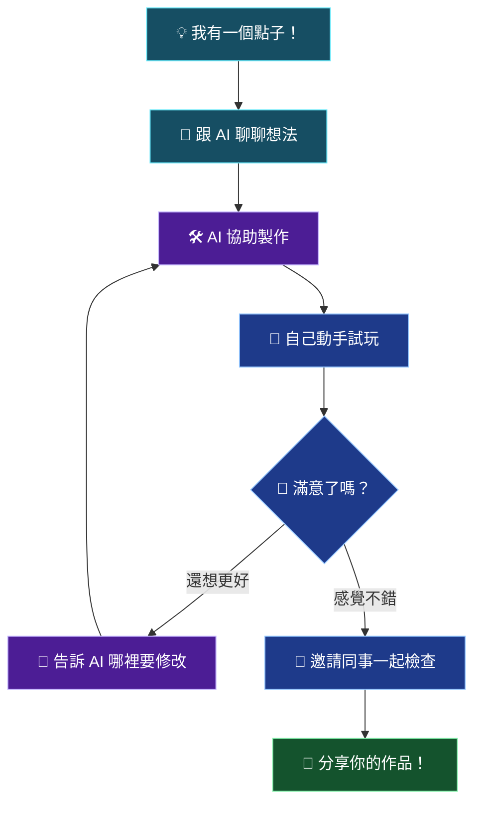
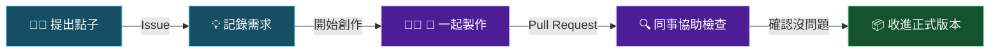

# 🚀 Tagtoo Vibe Coding Playground

### ✨ 有想法，就有機會做出來！

**Welcome to Tagtoo-2026! 🎉**

這裡是 Tagtoo 的 AI 創作實驗室，也是屬於每一位同事的數位遊樂場！ 🎡

你不需要是工程師，也不需要會寫程式。

只要你曾經想過：

- 💭「如果有個工具可以幫我做這件事就好了……」
- 😵「這個工作每天都要重複，真的不能自動化嗎？」
- 📊「我好想自己做一個報表或 Dashboard！」
- 🤩「我有個很酷的點子，但不知道怎麼做出來……」

**那麼，你來對地方了！**

> 🌟 **Everyone can build something amazing.**
>
> 每個人都可以是創作者。從一個小小的想法開始，一起做出有趣又實用的東西！

---

## 🌈 什麼是 Vibe Coding？

以前，想做一個軟體，你可能需要學會很多程式語言。

現在，你可以試著直接把想法告訴 AI，讓 AI 幫你寫程式、修改功能，甚至建立一個可以使用的小工具。

這就是我們說的 **Vibe Coding**！

| 🧑 你負責 | 🤖 AI 協助 |
|---|---|
| 💡 發想創意 | 🧩 規劃實作方式 |
| 🗣️ 描述需求 | 💻 撰寫程式 |
| 🎨 決定長相 | 🖼️ 製作介面 |
| 🧪 試用與回饋 | 🔧 修改問題 |
| 🎉 分享成果 | 🚀 協助準備展示 |

**你不一定要會寫 Code，但你可以學著成為自己點子的 Product Owner！**

當然，AI 也會犯錯，所以我們還是需要人來測試、檢查與做決定。

## 🎯 我們可以一起做什麼？

這裡沒有標準答案，只有等待被實現的創意！

| 創作領域 | 💡 可以挑戰的點子 |
|---|---|
| 📊 數據分析 | 自動產生圖表、互動式 Dashboard |
| 📣 行銷創意 | 活動企劃工具、文案產生器 |
| 💼 業務工作 | 客戶簡報助手、報價計算工具 |
| 🗂️ 行政效率 | 自動整理資料、排班小幫手 |
| 🎮 有趣實驗 | 小遊戲、抽獎工具、互動問答 |
| 🌟 任何奇想 | 只要你想得到，都值得試試！ |

這些是創作靈感，不是限定的專案清單。

**小工具也有大價值！** 如果能幫你每天省下 10 分鐘，就是很棒的開始。🙌

---

## 🗺️ 一個點子，如何變成真正的作品？

不用一開始就做到完美。

**先做出一個可以玩的版本，再慢慢讓它變好。**

這就是 Vibe Coding 最有趣的地方！✨

---

## 🏁 新手村：第一次加入怎麼開始？

### STEP 1 — 🪪 拿到你的創作者通行證

先註冊一個 [GitHub](https://github.com/) 帳號，並請 Organization 管理員邀請你加入 **Tagtoo-2026**。

GitHub 就像我們共同的作品倉庫，可以存放作品、記錄修改過程，也能跟同事一起協作。

### STEP 2 — 💡 找到你的第一個點子

從工作或生活中的一個小問題開始。

你可以試著用這個方式跟 AI 說：

> 我每天都需要整理 Excel 報表，花了很多時間。我想做一個小工具，讓我上傳 Excel 後，自動產生圖表。
>
> 我不會寫程式，請一步一步帶我完成，並告訴我怎麼測試。

不用擔心專業術語，**用你平常說話的方式描述就好！**

### STEP 3 — 🤖 找 AI 當你的創作夥伴

可以試試 ChatGPT、Claude、Codex 或其他經公司核准的 AI 工具。

讓 AI 幫你釐清需求、規劃步驟與製作原型。

不懂就問，做錯就改，AI 很適合陪你反覆練習！

### STEP 4 — 📦 把作品放到 GitHub

在適當的 Repository（專案倉庫）保存你的作品，或請同事協助建立。

建議每個專案至少簡單記錄：

- 🎯 這個工具要解決什麼問題？
- 👥 誰會使用它？
- ▶️ 要怎麼開始使用？
- 🧪 目前有哪些功能已經測試？
- 🚧 還有哪些地方需要改善？

### STEP 5 — 🎉 Show & Tell！

邀請同事看看你的作品！

不需要是多厲害的大系統，一個能解決小問題的工具就值得分享。

**每一次分享，都可能成為另一個人的靈感。**

---

## 📖 GitHub 小字典：不懂程式也能看懂！

GitHub 上有很多英文名詞，別害怕，把它們想成共同創作的工作空間就好。

| 名詞 | 白話解釋 |
|---|---|
| 🏢 Organization | 我們共同的創作園區 |
| 📦 Repository（Repo） | 一個專案的專屬資料夾 |
| 📝 README | 專案的使用說明書 |
| 💡 Issue | 點子、待辦事項或問題回報 |
| 🌿 Branch | 一個可以安心嘗試修改的版本 |
| 🔀 Pull Request（PR） | 提出修改，邀請大家確認 |
| 🕰️ Commit | 保存這一次修改的紀錄 |
| 👥 Team | 一起合作的夥伴群組 |

### 🤝 GitHub 怎麼幫助大家合作？

就像大家一起編輯文件，只是 GitHub 還會幫我們保存每次修改的歷史紀錄。

---

## 🏡 我們的創作公約

想讓這裡成為一個開心又安心的 AI 創作空間，我們有幾個小約定。

### 💚 1. 沒有笨問題，只有還沒問的問題

不懂 GitHub？不知道怎麼問 AI？

沒關係！這裡就是一起學習的地方。

### 🌱 2. 先完成，再完美

不需要等到作品 100 分才願意分享。

先做出能使用的小版本，再持續改進。

### 🤝 3. 分享比單打獨鬥更有趣

如果你的作品能幫助其他同事，歡迎分享使用方法、成果和遇到的挑戰。

一起改進，一起變強！

### 🛡️ 4. 創意很自由，資料安全不能隨便

AI 很方便，但請記得：

- 🔐 不要把密碼、API Key、Token 放進程式或 GitHub。
- 📁 客戶資料、個資、公司機密，只能在獲得授權的環境中使用。
- 🤖 不要把機敏資訊貼到未經公司核准的 AI 工具。
- 👀 分享前先確認 Repository 是 Public 還是 Private。
- 🧪 AI 產生的程式碼，使用前要測試；正式上線或連接公司系統前，請相關負責人審查。

**好玩的創意，要配上負責任的使用方式。**

### ❤️ 5. 尊重每個人的創作

不管點子大小、技術程度高低，都值得被認真對待。

我們鼓勵好奇、嘗試、分享，也鼓勵有建設性的回饋。

---

## ❓ 常見問題 FAQ

**Q：我完全不會寫程式，可以參加嗎？**

當然可以！🙌 你可以從提點子、描述需求、試用工具或回饋意見開始。

**Q：我需要自己安裝很多軟體嗎？**

不一定。要看專案使用的工具，有些只需要瀏覽器，有些需要額外設定。可以請 AI 或同事一步步協助。

**Q：AI 寫出來的東西一定能用嗎？**

不一定！AI 可能寫錯、理解錯需求，或忽略安全問題。記得親自測試，重要功能請同事協助確認。

**Q：如果我把程式改壞了怎麼辦？**

不用太緊張！GitHub 能記錄版本，可以協助找回過去的內容。不過重要資料仍需要妥善備份。

**Q：作品一定要跟工作有關嗎？**

不一定！有趣的小實驗也是很棒的學習起點。只要遵守公司資源與資訊安全規範，都歡迎探索。

---

## 🎉 Ready to Build Something?

每一個讓生活更方便的工具，都可能從一句話開始：

**「欸，我有一個想法……」**

在 Tagtoo-2026，我們希望讓更多人從軟體的使用者，慢慢成為創作者。

不需要等自己學會所有技術。

從一個點子、一個小問題、一次 AI 對話開始就好。

### 💡 Dream it. 🤖 Vibe it. 🛠️ Build it. 🚀 Share it.

**Let's build something awesome together!**

[🏠 前往 Tagtoo-2026](https://github.com/Tagtoo-2026)

---

Made with 💚, curiosity, creativity & a little bit of AI magic ✨

© Tagtoo-2026 · Keep Learning · Keep Creating · Keep Vibing
